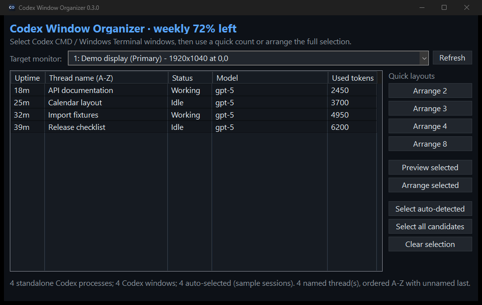
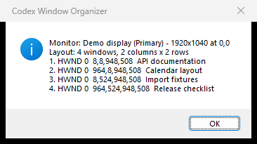

# XA Codex Organizer

XA Codex Organizer tiles standalone Codex CLI windows on a Windows monitor. Its session list shows thread names, status, model, used tokens, and process uptime so you can choose which conversations to put side by side.



## Arrange a workspace

1. Open separate Codex terminal windows and launch `CodexOrganizer.exe`. Select the target monitor and click **Refresh**. Tabs in one Windows Terminal window share a single position.
2. Select the sessions you want. **Preview selected** shows their order, sizes, and positions within the monitor’s usable area.
3. Choose **Arrange selected** to apply the preview, or use a **2**, **3**, **4**, or **8** window preset. Named threads sort alphabetically by default, with unnamed sessions last.



Both screenshots use fictional sessions and a simulated monitor. To preview from PowerShell, run `.\CodexOrganizer.exe --count 4 --dry-run` from the executable’s folder. Use `--list` to see which windows were detected.

## Build and run

On Windows 10 or newer, install Visual Studio 2022 with the x64 C++ build tools and Windows SDK, CMake 3.24 or later, and Python 3.10 or later for the build helper. From a fresh checkout, create your local configuration once, then build the release.

```powershell
Copy-Item config.json.example config.json
python -B ".\1. Build.py" --no-run --no-pause
```

Open `release\Codex Organizer\CodexOrganizer.exe`. Keep the staged `config.json` and `resources` folder alongside it. A machine running the compiled app needs the Microsoft Visual C++ x64 Redistributable. Python is only used for development.

## Session data and settings

The organizer reads a bounded portion of each visible terminal footer and uses the local Codex session index to resolve thread names. Use Codex’s `/statusline` picker to enable `used-tokens` if that column is blank. Process uptime appears when the organizer can associate a window with one Codex process.

Weekly account usage is enabled by default. On startup and refresh, the app can read the local Codex login and make an authenticated request to the configured usage endpoint. Set `"request_account_usage": false` in the executable’s `config.json` to turn this off. The same file controls the preferred window size, spacing, monitor, and confirmation before moving windows.

Licensed under the [Apache License 2.0](LICENSE).
